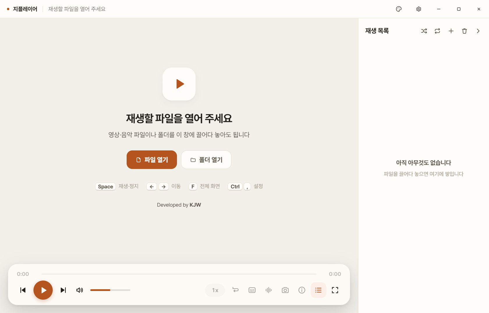

# 지플레이어 · GPlayer

가볍게 쓰는 Windows 영상·음악 플레이어. Developed by **KJW**.

**[최신 버전 다운로드](https://github.com/jiwooouuu/gplayer/releases/latest)**

## 설치

1. 최신 릴리스에서 `GPlayer_Setup.exe`를 다운로드합니다.
2. 설치 프로그램을 실행합니다. 기존 설치가 있으면 같은 위치에 설치합니다.
3. 바탕 화면 또는 시작 메뉴의 **지플레이어**를 실행합니다.

Windows 10/11 64비트용입니다. 별도 Python·FFmpeg 설치가 필요하지 않습니다.

## 주요 기능

- 영상·음악 재생, 폴더 열기와 재생 목록
- 파일 하나를 열면 그 파일만 추가, 목록의 + 메뉴에서 파일·폴더 추가
- 한 파일 재생·연속 재생·한 파일 반복·목록 반복, 순서 섞기
- 구간 반복, 배속, 프레임 이동, 자막·자막 싱크 조절
- 로컬 파일 직접 재생과 빠른 탐색, 연속 방향키 입력 병합
- 원본 해상도 장면 저장과 파일 규격 확인
- 설정 옆 팔레트 버튼에서 색상 미리보기를 보며 테마 10종 선택
- 영상 하단의 넓은 영역 어디에나 마우스를 두면 나타나는 반투명 재생 조작판
- 재생 중에만 하단을 벗어나면 조작판을 숨기고, 일시정지·재생 종료 시에는 계속 표시
- 조작판이 숨겨져 있어도 마우스를 움직이면 커서 표시

빠른 탐색은 가까운 기준 프레임으로 이동해 대기를 줄입니다. 영상에 따라 도착 시각은 몇 초 달라질 수 있습니다. **설정 → 재생 → 빠른 탐색**을 끄면 지정한 시각으로 정확히 이동합니다. 프레임 단위 이동·구간 반복은 항상 정확한 탐색을 사용합니다. 형식과 해상도, 저장 장치에 따라 탐색 시간은 달라집니다.

## 업데이트

최초 공개 버전 **1.0.0**부터 앱을 켤 때 이 저장소의 최신 릴리스를 확인합니다. 새 버전이 있으면 **업데이트 보기** 알림이 나타납니다.

**설정 → 정보 → 업데이트 확인 → 다운로드 → 플레이어를 종료하고 설치** 순서로 직접 진행할 수도 있습니다. 다운로드한 설치 파일은 SHA-256으로 검증한 뒤 실행합니다. 알림만으로 다운로드하거나 설치하지 않습니다.

**설정 → 정보 → 새 버전 알림**에서 실행 시 확인을 끌 수 있습니다. 업데이트 확인·다운로드에는 인터넷이 필요하며, 로컬 파일 재생에는 필요하지 않습니다. 영상 파일이나 재생 기록은 GitHub로 보내지 않습니다.

업데이트 기능이 없는 기존 로컬 시험판을 사용 중이라면 최초 한 번은 최신 설치 프로그램으로 설치해야 합니다.

같은 설치 위치에 업데이트하면 기존 바로가기와 파일 연결 등록을 보존합니다. 이전 설치 과정에서 이미 해제된 작업표시줄 고정이나 기본 앱 선택은 Windows에서 한 번 다시 지정해야 합니다.

## 단축키

| 기능 | 단축키 |
| --- | --- |
| 재생·정지 | Space |
| 앞뒤 이동 | ← / → |
| 전체 화면 | F |
| 재생 목록 | L |
| 장면 저장 | C |
| 파일 열기 | Ctrl+O |
| 설정 | Ctrl+, |

## 구성과 안내

이 저장소는 설치 파일과 사용 안내를 배포하는 공간입니다. 설치 파일은 **Releases**, 변경 사항은 **CHANGELOG.md**, 화면 예시는 **assets/**에 있습니다.

앱은 Electron, FFmpeg, Pretendard를 사용하며 각 구성 요소의 라이선스가 적용됩니다. 지플레이어의 별도 오픈소스 라이선스는 부여하지 않습니다.
